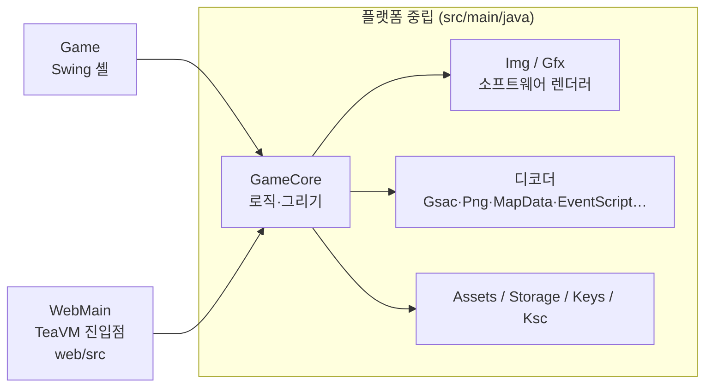

# 작업 정리 (2026-10-16 기준)

Android 게임 와일드 프론티어(`wild.apk`)를 `libwawa.so` 역공학으로 Java에 다시 구현한 작업의 현재 상태다.

- **브라우저:** https://camof1ow.github.io/wawa-java/ — 처음 한 번 자기 `wild.apk`를 고르면 브라우저(IndexedDB)에 보관해 다음부터 바로 시작한다. 파일은 어디에도 올라가지 않는다. (방향키 이동, Enter 확인·대화, F 빨리 넘기기, F5 저장, F9 불러오기)
- **데스크톱:** `java -cp out wawa.Game <자기 wild.apk>` (빌드는 README "Build and run")
- **배포 원칙:** 이 저장소는 공개 구동기만 담는다. 저장소와 사이트에는 원작의 어떤 부분도 없다(APK, 자산, 라이브러리, 디컴파일 코드). 디컴파일과 연구 자료는 공개하지 않는다.

## 1. 지금 되는 것

| 영역 | 내용 | 주요 클래스 |
|---|---|---|
| 오프닝 | 로고 3장, 타이틀(Play / Options / Help) | `TitleScreen` |
| 슬롯 화면 | 저장 슬롯 3개, 이어 하기·삭제, 새 게임 패널(이름·직업·능력치, 기본 이름 "크리스노아"), 직업 미리보기(정면, 서기·걷기 무작위 전환) | `SlotScreen` |
| 맵 | 지역 맵 타일(레이어별 팔레트 변형), 몬스터 배치(실제 이름·능력치·스프라이트), 포탈로 맵 이동. 보스·리젠 맵(포탈 5곳: b05→b19, d08→h21, e02→i61, j01→f21, z01→a11)은 원작의 경고창(GMenu 0x74)을 띄우고, "O.입장"이면 저장한 뒤 들어가고 "취소"면 머문다 | `MapData`, `Tiles`, `AreaInfo`, `MonsterTable`, `MonsterSprite`, `TalkBox` |
| 주인공 | 장비 층을 합성한 스프라이트, 서기·걷기·앉기. 키를 누르는 동안 8px/프레임으로 걷고(걷기 애니메이션), 스크립트 걷기·NPC 걷기도 진행 픽셀만큼 부드럽게 그린다. 맨손으로 시작해 스크립트가 주는 무기를 든다 | `HeroAnim`, `PartSprites`, `GameCore` |
| 지형 충돌 | 원작의 타일별 충돌 표(`g_anTileBlock`)로 맵마다 충돌 격자를 만든다(`LoadGameBlock`). 깊은 물·절벽·동굴 벽·용암은 막고, 얕은 물과 다리는 지나간다. 걷다가 지형에 막히면 1~2칸 옆이 트인 쪽으로 비켜 서서 계속 걷는다(`NewCollPath`, 얼굴 방향은 그대로). 스크립트 걷기도 지형에 막힌다. 몬스터는 id별 마스크(`g_anMonsBlock`: 175종은 주인공과 같은 지형, 33종은 깊은 물을 건넘, 4종은 모두 통과)로 같은 격자에 막힌다 | `BlockGrid`, `GameCore` |
| 이벤트 스크립트 | `eve/*.evk` 해석기: 자막, 대화(얼굴·이름·타자), NPC 유닛, 카메라, 페이드, 흔들기, 선택지 | `EventScript`, `EventRunner`, `TalkBox` |
| 전투·저장 | 칸 이동, 턴제 전투, 물약(2번 키: 가진 HP 포션 중 가장 싼 것을 원작 사용 스크립트로 마심), 슬롯 저장·불러오기 | `GameCore`, `Hero`, `Combat` |
| 소지품 | 원작 영웅 기록의 구조 그대로: 장비 인스턴스 50칸(쓸 수 있는 칸 20)과 묶음 305칸(재료 40·소모품 12·기타 30·제작서 30), 골드. `AddItem`/`DelItem`/`SortItem`/`GetItemCount` 규칙, 스크립트의 아이템 지급·회수·개수 조건(종류 0 묶음 포함)과 즉시 장착, 골드 대입(`hero+0xa4`). 장착한 무기가 공격, 갑옷·투구(직업 1은 방패도)가 방어에 들어가고 외형도 바뀐다. 새 게임은 원작 `InitHero`처럼 골드 0, 빈 가방으로 시작한다 | `Inventory`, `Item`, `Hero`, `HeroAnim` |
| 입력 | 키보드, 한글 입력기(이름 입력), 마우스 클릭 | `Game`, `WebMain` |

새 게임의 `t01` 오프닝은 끝까지 진행된다(1359프레임). 22개 맵의 시작 이벤트도 모두 멈추지 않고 끝난다.

## 2. 구조

- **`GameCore`:** 게임 전체를 담는다. `tick()`(62ms), `render(Gfx)`(416×312), `key`, `typed`, `click`을 제공한다. AWT·Swing·`java.nio.file`은 쓰지 않는다.
- **`Game`(데스크톱):** 창 맞춤 확대, 타이머, 키·입력기·마우스 전달을 맡는다. 저장은 `wawa-slotN.properties` 파일에 하고, `--selftest`로 창 없이 화면 PNG를 만든다.
- **`WebMain`(웹):** 페이지가 넘겨준 사용자 `wild.apk`를 메모리에서 풀고, canvas에 그린다. 와일드 프론티어 APK가 아니면 보관본을 지우고 다시 묻는다. 저장은 localStorage(`wawa-` 접두사)에 한다.
- **자산 접근:** `Assets`가 APK 루트 기준 경로("assets/img/x.png")로 읽는다. 데스크톱 구현은 `ApkAssets`(APK)와 `DirAssets`(풀어 둔 폴더)이고, 웹은 `Assets.of(Map)`이다.
- **한글 인코딩:** TeaVM에는 MS949가 없다. 그래서 EUC-KR ⇄ 유니코드 변환은 `Ksc`가 자체 표 `KscTable`로 한다.

## 3. 웹 실행: CheerpJ → TeaVM

처음 웹판은 CheerpJ(브라우저 안의 JVM)로 jar를 그대로 돌렸다. JVM 부팅만 약 12초가 걸려서, 코드를 TeaVM 0.14.1로 미리 JavaScript로 컴파일하는 방식으로 바꿨다.

| 측정 (실사이트, 캐시 없음) | CheerpJ | TeaVM |
|---|---|---|
| 첫 화면 | 19.6초 | 4.5초 |
| 조작 가능 | 30.7초 | 4.6초 |

- **로컬 측정:** 첫 화면 1.3초, 조작 가능 1.4초.
- **받는 파일:** `wawa.js` 518 KB, 글꼴 633 KB. `wild.apk`(24.9 MB)는 사용자 파일이라 받지 않는다.
- **빌드:** `sh ./gradlew generateJavaScript`(JAVA_HOME은 JDK 17)를 돌리면 `build/generated/teavm/js/wawa.js`가 나온다. Pages 워크플로(`.github/workflows/pages.yml`)가 main에 push할 때마다 빌드해서 배포한다.
- **데스크톱 빌드:** 바뀌지 않았다. `javac`로 컴파일한 뒤 `src/main/resources`를 출력 폴더에 복사하면 된다.

## 4. 글자 그리기

- **문제:** 원작 화면(480×320)을 캔버스(416×277)에 줄여 붙이면, 원작 비트맵 글꼴의 픽셀이 빠져 글자가 깨졌다.
- **해결:** 글자를 픽셀 버퍼에 굽지 않는다.
  - `Gfx.drawText`는 글자마다 원작 글자 칸의 위치·색·클립만 `Img.text`에 남긴다.
  - 화면을 창 크기로 늘린 뒤, 그 해상도에서 벡터 글꼴로 그린다(웹 `fillText`, 데스크톱 Java2D).
- **글꼴:** GalmuriMono11(SIL OFL 1.1). 한글 폭이 영문의 두 배라 원작 칸(한글 16px, 영문 8px)과 비율이 같아서, 줄바꿈과 배치가 원작 그대로다.
  - KS X 1001 한글·기호·ASCII만 남긴 부분집합을 쓴다.
  - 파일은 `src/main/resources/wawa/GalmuriMono11.ttf`이고, 라이선스 파일이 같은 폴더에 있다.
- **원작 규칙 유지:** 어느 글자를 그리고 얼마나 전진하는지는 원작 `DrawString`(0x365f4) 규칙(`Font`)을 그대로 쓴다.
- **근사 처리:** 글자 위에 덮이는 그림(페이드 등)은 글자 중심 픽셀의 색을 글자색에 섞는 식으로 처리한다.

## 5. 검증 방법

원작을 직접 돌려 비교할 환경이 이 PC에 없다. MuMu Player는 armeabi APK를 설치하지 못하고, QEMU 이미지는 이 PC에 없다. 그래서 이벤트 명령은 원작 코드에서 그 값을 쓰는 곳까지 추적해 검증했다.

| 검증 | 명령 | 기대 결과 |
|---|---|---|
| 셀프 테스트 | `java -cp out wawa.Game <wild.apk> --selftest` (먼저 `wawa-slot*.properties` 삭제) | `intro frames=1359 running=false map=t01 hero=11,15 var1=1 …`, `walk frames=22 hero=0,15 dir=2`, `mapmove map=t02 hero=23,14 dir=2 frames=302 …`, `slot=0 name=와와 class=1 map=a01 …`, `terrain 27,10->27,10 dir=3 15,17->16,18 dir=1`(깊은 바다에 막힘, 바위를 오른쪽으로 비켜 감), `monster-terrain 27 28 28`(마스크 0x2b는 깊은 바다에 막히고 0x02·0은 건넘), `bossgate asked=true cancel=z01 enter=a11`(경고창이 뜨고, 취소하면 머물고, 입장하면 들어감), `inventory add=0,0 slots=99/61 left=0 slots=60/0 count=60 slot3=false slot1=true worn=true roundtrip=true`(AddItem·DelItem·장착·저장 왕복), `potion hp=1->133 …`(하급 포션이 전역 phase 3으로 회복), `out/*.png` 17장(2배 크기, `bossgate.png` 포함) |
| 맵 전체 로드 | `java -cp out wawa.CheckMapsRun <assets>` | `failures=0` |
| 디코더 동등성(전환 때 1회) | 옛 AWT 경로와 새 `Img` 경로의 픽셀 비교 | Gsac 132개(4582프레임), PNG 75개, 포즈 2784개, 이벤트 문장 135개에서 차이 0 |
| 웹 | 로컬 정적 서버에서 타이틀 → 새 게임 → 한글 이름 → 오프닝 → F5 저장 → 새로고침 → 불러오기 | 모두 통과 |

## 6. 커밋 이력

| 커밋 | 내용 |
|---|---|
| `5546c6b` | 첫 Java 포트 |
| `4e7914f` | 오프닝, 슬롯 화면, 주인공 스프라이트 |
| `9b1dca1` | 이벤트 스크립트 해석기와 대화창 |
| `fb0ecaf` | 웹 빌드(CheerpJ)와 Pages 배포 |
| `48b2e23` | 원작에 없는 상시 미니맵 제거 |
| `dca477a` | 컷씬 나타남·사라짐 명령(93/a3, 43/53)이 뒤바뀐 문제 수정 |
| `5b165d0` | 파일 선택 없이 바로 실행(APK 동봉은 `9d0a4e0`에서 철회하고 히스토리에서도 지움) |
| `01d07b2` | 이벤트 명령 검증 반영, 창 맞춤, 한글 입력, 기본 이름 |
| `2da26f3` | CheerpJ 첫 화면 앞당김(런타임 미리 받기, 백그라운드 로딩) |
| `d81e708` | TeaVM 전환, 벡터 글자, 웹 저장 수정 |
| `9d0a4e0` | 원작을 배포하지 않음: 웹은 사용자 `wild.apk`를 한 번 골라 브라우저에 보관 |
| `871f1f6` | 공개 저장소는 구동기만 담고, 연구 자료는 히스토리에서도 뺌 |

## 7. 남은 일

**아직 포팅하지 않은 것**
- **이벤트:** 퀘스트, 버프, 사운드, 확대, 데미지 숫자가 없다. GMenu/GOrder 화면 중 남은 것은 퀘스트 제안 GMenu 100(이벤트 132줄), 상점 계열 GOrder 0xd(lo 2 hi 0·1·2 z01, hi 3 8번, hi 6 7번), 퀘스트 게시판 GOrder 8(마을 6곳)이다. 모두 인벤토리나 퀘스트 상태가 있어야 한다. 그 밖에 `04`, 엔딩 `8b`, 효과·공격 동작, 맵 오브젝트 `c3`/`d3`, SetCamping `75..a5`가 남았다. 만나면 `[미포팅]` 로그를 남기고 건너뛴다.
- **보스·리젠 맵:** 원작은 그 맵의 리젠 기록(`GetRegen`)이 살아 있으면 묻지 않고 들어가는데, 포트는 리젠 기록이 없어서 매번 묻는다. 경고문은 "입장 후 저장할 수 없습니다"라고 하지만 포트는 보스 맵에서도 F5 저장을 막지 않는다.
- **게임 시스템:** 인벤토리·장비 화면(메뉴 ITEM 탭)과 상점이 없다(진행 중인 ②·③단계). 몬스터는 정지 포즈만 있다. 주인공의 공격·스킬·탈것 동작이 없다.
- **소지품 남은 것:** 장비 옵션·룬·소켓의 효과, 아이템 쿨다운(`hero+0x388`), 빠른 슬롯, 전투 중 내구도 감소와 수리, NPC 이벤트 전 가방 검사(가득 차면 GMenu 0x386)가 없다. 몬스터가 떨구는 아이템 대신 포트가 처치 3번에 1번꼴로 하급 포션을 준다. 쓰러지면 포트는 골드 50을 잃지만 원작은 2.5%(헬 5%)를 잃는다.
- **충돌 남은 것:** 맵 오브젝트 발자국(`LoadGameBlock`의 bit 0)과 배치 항목 발자국(0x08·0x10·0x20)은 격자에 넣지 않았다. 오브젝트를 아직 그리지 않아서 보이지 않는 벽이 되기 때문이다. 몬스터 마스크도 지형 비트만 쓴다. 스크립트 걷기와 몬스터에는 비켜 서기를 넣지 않았다. 대각 걷기는 목적 칸이 지형이면 멈추지만, 원작은 x·y를 1px씩 따로 움직여 벽을 타고 미끄러진다.
- **이동 근사:** 원작은 주인공을 픽셀 좌표로 두지만 포트는 칸 + 진행 픽셀이다. 그래서 키를 떼거나 방향을 바꿀 때 칸 중심까지 마저 걷고(최대 1프레임·8px), 오른쪽·아래로 갈 때 칸이 바뀌는 시점이 1프레임 늦다.
- **슬롯 화면:** 배경의 캠프 오브젝트(`SetCamping`, `.mbk` 맵 오브젝트)가 없다.

**알려진 화면 문제 (TeaVM 전환 전부터 있음)**
- 슬롯 팝업에서 `MODE`·`PLAY TIME`·`LEVEL` 줄이 서로 겹친다.
- 맵 아래 지역명 줄이 반쯤 잘린다.

**다음 후보**
- 모바일 가상 패드: 원작의 `handleCletEvent`, `PadPointerEvent`, `assets/control/btn_*` 이미지를 쓴다.
