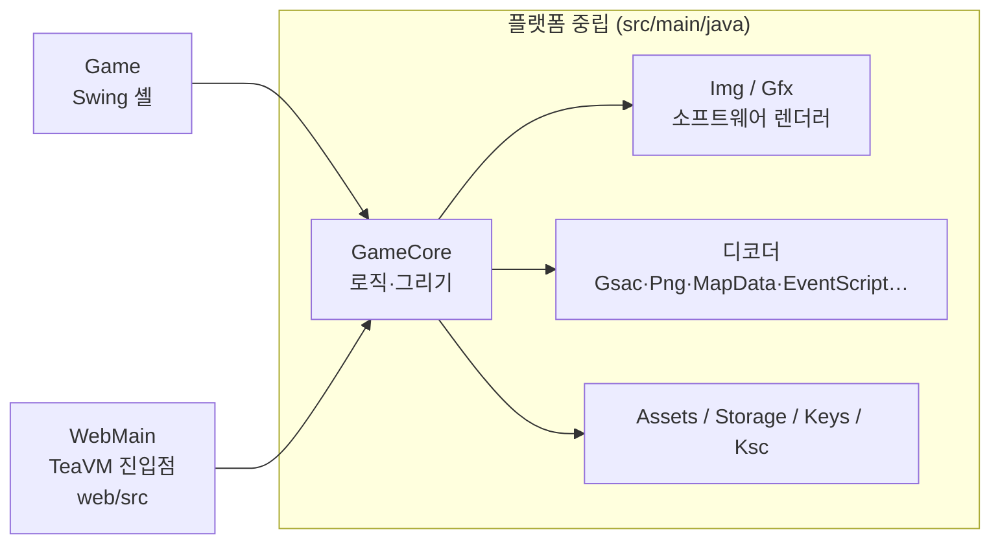

# 작업 정리 (2026-10-16 기준)

Android 게임 와일드 프론티어(`wild.apk`)를 `libwawa.so` 역공학으로 Java에 다시 구현한 작업의 현재 상태다.

- **브라우저:** https://camof1ow.github.io/wawa-java/ — 처음 한 번 자기 `wild.apk`를 고르면 브라우저(IndexedDB)에 보관해 다음부터 바로 시작한다. 파일은 어디에도 올라가지 않는다. (방향키 이동, Enter 확인·대화, F 빨리 넘기기, F5 저장, F9 불러오기)
- **데스크톱:** `java -cp out wawa.Game <자기 wild.apk>` (빌드는 README "Build and run")
- **배포 원칙:** 이 저장소는 공개 구동기만 담는다. 저장소와 사이트에는 원작의 어떤 부분도 없다(APK, 자산, 라이브러리, 디컴파일 코드). 디컴파일과 연구 자료는 공개하지 않는다.

## 1. 지금 되는 것

| 영역 | 내용 | 주요 클래스 |
|---|---|---|
| 오프닝 | 로고 3장, 타이틀(Play / Options / Help) | `TitleScreen` |
| 슬롯 화면 | 저장 슬롯 3개, 이어 하기·삭제, 새 게임 패널(이름·직업·능력치, 기본 이름 "크리스노아"), 직업 미리보기(정면, 서기·걷기 무작위 전환) | `SlotScreen` |
| 맵 | 지역 맵 타일(레이어별 팔레트 변형), 몬스터 배치(실제 이름·능력치·스프라이트), 포탈로 맵 이동 | `MapData`, `Tiles`, `AreaInfo`, `MonsterTable`, `MonsterSprite` |
| 주인공 | 장비 층을 합성한 스프라이트, 서기·걷기·앉기. 키를 누르는 동안 8px/프레임으로 걷고(걷기 애니메이션), 스크립트 걷기·NPC 걷기도 진행 픽셀만큼 부드럽게 그린다. 맨손으로 시작해 스크립트가 주는 무기를 든다 | `HeroAnim`, `PartSprites`, `GameCore` |
| 이벤트 스크립트 | `eve/*.evk` 해석기: 자막, 대화(얼굴·이름·타자), NPC 유닛, 카메라, 페이드, 흔들기, 선택지 | `EventScript`, `EventRunner`, `TalkBox` |
| 전투·저장 | 칸 이동, 턴제 전투, 물약, 슬롯 저장·불러오기 | `GameCore`, `Hero`, `Combat` |
| 입력 | 키보드, 한글 입력기(이름 입력), 마우스 클릭 | `Game`, `WebMain` |

새 게임의 `t01` 오프닝은 끝까지 진행된다(1359프레임). 22개 맵의 시작 이벤트도 모두 멈추지 않고 끝난다.

## 2. 구조

- **`GameCore`:** 게임 전체를 담는다. `tick()`(62ms), `render(Gfx)`(416×312), `key`, `typed`, `click`을 제공한다. AWT·Swing·`java.nio.file`은 쓰지 않는다.
- **`Game`(데스크톱):** 창 맞춤 확대, 타이머, 키·입력기·마우스 전달을 맡는다. 저장은 `wawa-slotN.properties` 파일에 하고, `--selftest`로 창 없이 화면 PNG를 만든다.
- **`WebMain`(웹):** 페이지가 넘겨준 사용자 `wild.apk`를 메모리에서 풀고, canvas에 그린다. 와일드 프론티어 APK가 아니면 보관본을 지우고 다시 묻는다. 저장은 localStorage(`wawa-` 접두사)에 한다.
- **자산 접근:** `Assets`가 APK 루트 기준 경로("assets/img/x.png")로 읽는다. 데스크톱 구현은 `ApkAssets`(APK)와 `DirAssets`(풀어 둔 폴더)이고, 웹은 `Assets.of(Map)`이다.
- **한글 인코딩:** TeaVM에는 MS949가 없다. 그래서 EUC-KR ⇄ 유니코드 변환은 `Ksc`가 자체 표 `KscTable`로 한다.

## 3. 웹 실행: CheerpJ → TeaVM

처음 웹판은 CheerpJ(브라우저 안의 JVM)로 jar를 그대로 돌렸다. JVM 부팅만 약 12초가 걸려서, 코드를 TeaVM 0.14.1로 미리 JavaScript로 컴파일하는 방식으로 바꿨다.

| 측정 (실사이트, 캐시 없음) | CheerpJ | TeaVM |
|---|---|---|
| 첫 화면 | 19.6초 | 4.5초 |
| 조작 가능 | 30.7초 | 4.6초 |

- **로컬 측정:** 첫 화면 1.3초, 조작 가능 1.4초.
- **받는 파일:** `wawa.js` 518 KB, 글꼴 633 KB. `wild.apk`(24.9 MB)는 사용자 파일이라 받지 않는다.
- **빌드:** `sh ./gradlew generateJavaScript`(JAVA_HOME은 JDK 17)를 돌리면 `build/generated/teavm/js/wawa.js`가 나온다. Pages 워크플로(`.github/workflows/pages.yml`)가 main에 push할 때마다 빌드해서 배포한다.
- **데스크톱 빌드:** 바뀌지 않았다. `javac`로 컴파일한 뒤 `src/main/resources`를 출력 폴더에 복사하면 된다.

## 4. 글자 그리기

- **문제:** 원작 화면(480×320)을 캔버스(416×277)에 줄여 붙이면, 원작 비트맵 글꼴의 픽셀이 빠져 글자가 깨졌다.
- **해결:** 글자를 픽셀 버퍼에 굽지 않는다.
  - `Gfx.drawText`는 글자마다 원작 글자 칸의 위치·색·클립만 `Img.text`에 남긴다.
  - 화면을 창 크기로 늘린 뒤, 그 해상도에서 벡터 글꼴로 그린다(웹 `fillText`, 데스크톱 Java2D).
- **글꼴:** GalmuriMono11(SIL OFL 1.1). 한글 폭이 영문의 두 배라 원작 칸(한글 16px, 영문 8px)과 비율이 같아서, 줄바꿈과 배치가 원작 그대로다.
  - KS X 1001 한글·기호·ASCII만 남긴 부분집합을 쓴다.
  - 파일은 `src/main/resources/wawa/GalmuriMono11.ttf`이고, 라이선스 파일이 같은 폴더에 있다.
- **원작 규칙 유지:** 어느 글자를 그리고 얼마나 전진하는지는 원작 `DrawString`(0x365f4) 규칙(`Font`)을 그대로 쓴다.
- **근사 처리:** 글자 위에 덮이는 그림(페이드 등)은 글자 중심 픽셀의 색을 글자색에 섞는 식으로 처리한다.

## 5. 검증 방법

원작을 직접 돌려 비교할 환경이 이 PC에 없다. MuMu Player는 armeabi APK를 설치하지 못하고, QEMU 이미지는 이 PC에 없다. 그래서 이벤트 명령은 원작 코드에서 그 값을 쓰는 곳까지 추적해 검증했다.

| 검증 | 명령 | 기대 결과 |
|---|---|---|
| 셀프 테스트 | `java -cp out wawa.Game <wild.apk> --selftest` (먼저 `wawa-slot*.properties` 삭제) | `intro frames=1359 running=false map=t01 hero=11,15 var1=1 …`, `walk frames=22 hero=0,15 dir=2`, `mapmove map=t02 hero=23,14 dir=2 frames=302 …`, `slot=0 name=와와 class=1 map=a01 …`, `out/*.png` 16장(2배 크기) |
| 맵 전체 로드 | `java -cp out wawa.CheckMapsRun <assets>` | `failures=0` |
| 디코더 동등성(전환 때 1회) | 옛 AWT 경로와 새 `Img` 경로의 픽셀 비교 | Gsac 132개(4582프레임), PNG 75개, 포즈 2784개, 이벤트 문장 135개에서 차이 0 |
| 웹 | 로컬 정적 서버에서 타이틀 → 새 게임 → 한글 이름 → 오프닝 → F5 저장 → 새로고침 → 불러오기 | 모두 통과 |

## 6. 커밋 이력

| 커밋 | 내용 |
|---|---|
| `d4b2f3c` | 포맷 해석과 첫 Java 포트 |
| `9721968` | 오프닝, 슬롯 화면, 주인공 스프라이트 |
| `3ea79a5` | 이벤트 스크립트 해석기와 대화창 |
| `e117701` | 웹 빌드(CheerpJ)와 Pages 배포 |
| `827057c` | 원작에 없는 상시 미니맵 제거 |
| `b8809ad` | 컷씬 나타남·사라짐 명령(93/a3, 43/53)이 뒤바뀐 문제 수정 |
| `81b8426` | 파일 선택 없이 바로 실행(APK 동봉은 `e33f1f2`에서 철회하고 히스토리에서도 지움) |
| `e00088f` | 이벤트 명령 검증 반영, 창 맞춤, 한글 입력, 기본 이름 |
| `786191c` | CheerpJ 첫 화면 앞당김(런타임 미리 받기, 백그라운드 로딩) |
| `c4ab817` | TeaVM 전환, 벡터 글자, 웹 저장 수정 |
| `e33f1f2` | 원작을 배포하지 않음: 웹은 사용자 `wild.apk`를 한 번 골라 브라우저에 보관 |

## 7. 남은 일

**아직 포팅하지 않은 것**
- **이벤트:** 퀘스트, 버프, 사운드, 확대, 데미지 숫자, GOrder/GMenu 화면이 없다. 보스·리젠 맵 11곳은 원작에서 `GMenu 0x74`를 거쳐 들어가므로 포트에서는 들어가지 못한다. 그 밖에 `04`, 엔딩 `8b`, 효과·공격 동작, 맵 오브젝트 `c3`/`d3`, SetCamping `75..a5`가 남았다. 만나면 `[미포팅]` 로그를 남기고 건너뛴다.
- **게임 시스템:** 인벤토리·장비 화면이 없다. 몬스터는 정지 포즈만 있다. 주인공의 공격·스킬·탈것 동작이 없다. 지형 충돌(`CollHeroPath`)이 없어 맵 경계와 몬스터만 막는다.
- **이동 근사:** 원작은 주인공을 픽셀 좌표로 두지만 포트는 칸 + 진행 픽셀이다. 그래서 키를 떼거나 방향을 바꿀 때 칸 중심까지 마저 걷고(최대 1프레임·8px), 오른쪽·아래로 갈 때 칸이 바뀌는 시점이 1프레임 늦다.
- **슬롯 화면:** 배경의 캠프 오브젝트(`SetCamping`, `.mbk` 맵 오브젝트)가 없다.

**알려진 화면 문제 (TeaVM 전환 전부터 있음)**
- 슬롯 팝업에서 `MODE`·`PLAY TIME`·`LEVEL` 줄이 서로 겹친다.
- 맵 아래 지역명 줄이 반쯤 잘린다.

**다음 후보**
- 모바일 가상 패드: 원작의 `handleCletEvent`, `PadPointerEvent`, `assets/control/btn_*` 이미지를 쓴다.
