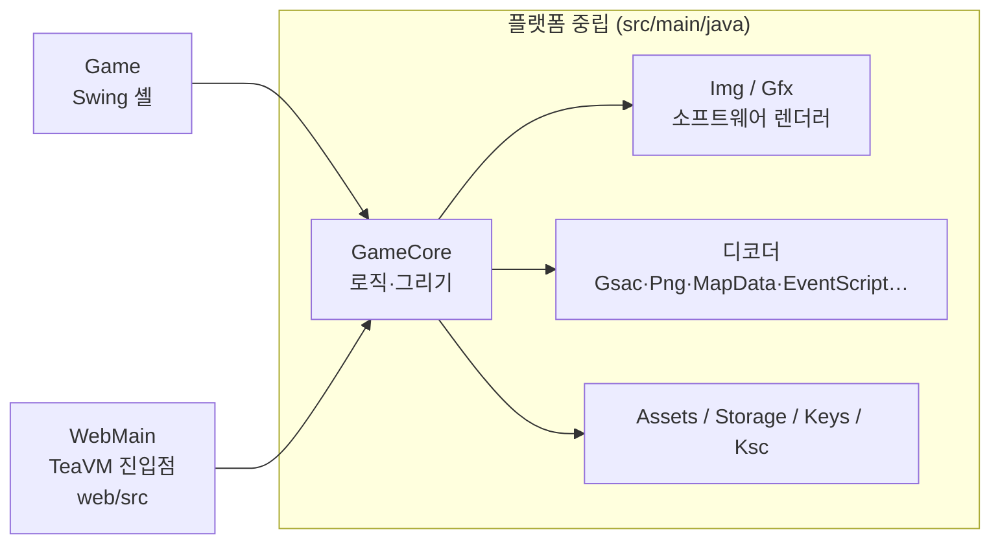

# 작업 정리 (2026-10-16 기준)

Android 게임 와일드 프론티어(`wild.apk`)를 `libwawa.so` 역공학으로 Java에 다시 구현한 작업의 현재 상태다.

- **브라우저:** https://camof1ow.github.io/wawa-java/ — 처음 한 번 자기 `wild.apk`를 고르면 브라우저(IndexedDB)에 보관해 다음부터 바로 시작한다. 파일은 어디에도 올라가지 않는다. (방향키 이동, Enter 확인·대화, F 빨리 넘기기, F5 저장, F9 불러오기)
- **데스크톱:** `java -cp out wawa.Game <자기 wild.apk>` (빌드는 README "Build and run")
- **배포 원칙:** 이 저장소는 공개 구동기만 담는다. 저장소와 사이트에는 원작의 어떤 부분도 없다(APK, 자산, 라이브러리, 디컴파일 코드). 디컴파일과 연구 자료는 공개하지 않는다.

## 1. 지금 되는 것

| 영역 | 내용 | 주요 클래스 |
|---|---|---|
| 오프닝 | 로고 3장, 타이틀(Play / Options / Help) | `TitleScreen` |
| 슬롯 화면 | 저장 슬롯 3개, 이어 하기·삭제, 새 게임 패널(이름·직업·능력치, 기본 이름 "크리스노아"), 직업 미리보기(정면, 서기·걷기 무작위 전환) | `SlotScreen` |
| 맵 | 지역 맵 타일(레이어별 팔레트 변형), 몬스터 배치(실제 이름·능력치·스프라이트), 포탈로 맵 이동. 보스·리젠 맵(포탈 5곳: b05→b19, d08→h21, e02→i61, j01→f21, z01→a11)은 원작의 경고창(GMenu 0x74)을 띄우고, "O.입장"이면 저장한 뒤 들어가고 "취소"면 머문다 | `MapData`, `Tiles`, `AreaInfo`, `MonsterTable`, `MonsterSprite`, `TalkBox` |
| 주인공 | 장비 층을 합성한 스프라이트, 서기·걷기·앉기. 키를 누르는 동안 8px/프레임으로 걷고(걷기 애니메이션), 스크립트 걷기·NPC 걷기도 진행 픽셀만큼 부드럽게 그린다. 맨손으로 시작해 스크립트가 주는 무기를 든다 | `HeroAnim`, `PartSprites`, `GameCore` |
| 지형 충돌 | 원작의 타일별 충돌 표(`g_anTileBlock`)로 맵마다 충돌 격자를 만든다(`LoadGameBlock`). 깊은 물·절벽·동굴 벽·용암은 막고, 얕은 물과 다리는 지나간다. 걷다가 지형에 막히면 1~2칸 옆이 트인 쪽으로 비켜 서서 계속 걷는다(`NewCollPath`, 얼굴 방향은 그대로). 스크립트 걷기도 지형에 막힌다. 몬스터는 id별 마스크(`g_anMonsBlock`: 175종은 주인공과 같은 지형, 33종은 깊은 물을 건넘, 4종은 모두 통과)로 같은 격자에 막힌다 | `BlockGrid`, `GameCore` |
| 이벤트 스크립트 | `eve/*.evk` 해석기: 자막, 대화(얼굴·이름·타자), NPC 유닛, 카메라, 페이드, 흔들기, 선택지 | `EventScript`, `EventRunner`, `TalkBox` |
| 전투·저장 | 실시간 근접 공격(1번 키): 원작 콤보 9→0xa→0xf, 무기별 프레임(`g_anHeroAttactFrame`)·지연(`g_anWeaponAttactDelay`), 판정 사각형(`g_arcHeroAttactRect`)과 몬스터 피격 범위(`g_arcMonsBlow_LE`)로 여러 마리 동시 타격, 자동 조준(`CheckHeroOnMons`). 몬스터는 맞으면 경직(상태 8)·밀림(`g_anUnitPushed`), 죽으면 날아감(상태 0xf, `g_aptKnock`) 뒤 시체(상태 9)로 640프레임 남았다가 사라진다. 처치는 경험치만 준다. 몬스터 AI(`CalcMonsAct`): 숨기·서기·배회(대기/이동 횟수 표, 스폰 ±48px 순찰 범위, 벗어나면 귀환), 시야 사각형(`g_arcMonsLook_E`)으로 발견("!" 말풍선, 경계 상태 5), 최단 경로 탐색(`GetMonsRouting`, 몸 크기 충돌)으로 공격 위치까지 추격, 공격 사각형(`g_arcMonsAttack_E`)에 들면 공격(상태 6)하고 공격 프레임 안에서 원작 순서대로 명중·방패 막기·치명타·경직을 굴린다. HP 1/3 이하에서 도망가는 종류는 땀 말풍선과 함께 달아난다. 주인공은 맞으면 경직(동작 3, 끝날 때까지 무적·공격 대기), 갑옷·투구·어깨·방패 내구도가 닳는다. 갈무리(동작 2): 시체 위에서 OK 말풍선이 뜨고, 근처에 산 몬스터가 없을 때 1번을 누르면 바로, 싸우는 중에는 9프레임 누르고 있으면 시작한다. 누르고 있는 동안 12프레임마다(크기+1번) 실패 50%(충전 5프레임 미만)·개수 1~3·레벨 가중 등급으로 재료(`g_anMonsDrop`/`g_anMonsItem`)를 얻고, 첫 칸은 2% 룬(`RandWeight10000`·`g_anRuneDrop`·`g_anRuneProb`)이나 20% 제작서(등급 굴림)로 바뀐다. 4프레임 안에 떼면 취소, 그 뒤에 떼거나 방향·공격·메뉴 닫기는 조기 종료다. 게이지(gameui 0x4a~0x55), 시체 잠금(0xfb/0xfc)과 페이드, 가방 가득 참 문구. 피해 숫자·MISS·치명타 표시(`DrawAndDestroyDamage`), 콤보 카운터, 방향 흔들기, 화면 위 대상 HP 막대(36프레임). 마을에서는 공격할 수 없다(`map+0x2d == 1`, 보스가 있는 맵 제외). 물약(2번 키), 슬롯 저장·불러오기 | `GameCore`, `Fight`, `Hero`, `Combat` |
| 소지품 | 원작 영웅 기록의 구조 그대로: 장비 인스턴스 50칸(쓸 수 있는 칸 20)과 묶음 305칸(재료 40·소모품 12·기타 30·제작서 30), 골드. `AddItem`/`DelItem`/`SortItem`/`GetItemCount` 규칙, 스크립트의 아이템 지급·회수·개수 조건(종류 0 묶음 포함)과 즉시 장착, 골드 대입(`hero+0xa4`). 장착한 무기가 공격, 갑옷·투구(직업 1은 방패도)가 방어에 들어가고 외형도 바뀐다. 새 게임은 원작 `InitHero`처럼 골드 0, 빈 가방으로 시작한다 | `Inventory`, `Item`, `Hero`, `HeroAnim` |
| 메뉴 ITEM 탭 | `I`·Backspace(원작 CLEAR)로 연다. 원작 시트(`gorder`·`imenu`·`gameui`·`icon0..7`)와 정적 clix 표 배치 그대로: 탭 열, 카테고리 5개(장비·소모품·재료·기타·제작서), 장비 슬롯 12칸, 가방 격자·스크롤·칸 수, 주인공 미리보기·레벨·HP/SP, 돈·ATK·DEF, 아이템 요약. `KeyPressGOrderItem`의 커서·감김 규칙, 팝업(`DrawItemSelect`)의 장착·해제·사용·상세보기·버리기, 확인창 GMenu 0xcc·0xce, 메시지 0x38e | `ItemMenu`, `Clix`, `Gsac` |
| 상점 | 이벤트 lo 2가 여는 GOrder 0xd(구매)·0xe(판매), 모드 0·1(카테고리 탭 4개)·3(잡화)·6(잡화를 등급 범위만큼). 원작 상품표(`0x10b968..`), 가격(`GetGOrderItemCost`: 구매 기본가×2, 판매 기본가, 도박 장비 60), BUY/SELL 막대와 `KeyPressGOrderBuySell` 규칙, 수량 팝업 0xca·0xcb(←→ 1, ↑↓ 10)와 장비 팝업 0xcf·0xd0, 메시지 0x385·0x386, 상점 주인(말을 건 NPC) 그리기 | `ShopMenu`, `OrderScreen` |
| 퀘스트 | `dat/quesn` 265개 정의(제목·설명·과제·보상, 처치·조건·스킬·시간·드롭 목록, 보상 phase). 주인공 슬롯 7개(메인 0, 서브 1~4, 자유 5~6)와 퀘스트별 상태 바이트. 이벤트 `21`이 여는 GMenu 100(제목, 설명과 과제 요약, 메인은 "닫기", 서브·자유는 예/아니오; 거절이나 빈 칸 없음은 실행 중인 phase를 닫고 후자는 GMenu 900), `31` 완료(보상 phase 실행, 가방이 차면 GMenu 0x386, 일일 자유 퀘스트는 날짜 코드), 조건 0x14~0x17(진행 중·실패·완료 대기·완료한 적 있음). `AnalysisQuest`(phase 끝, 맵 진입, 메뉴·상점 닫기, 레벨 업), 처치 수(`CheckQuestMons`, 이름 있는 유닛 제외), 아이템 수(`CheckQuestItem`: 갈무리·이벤트 지급·상점 구매), 기본 공격 스킬 수, 시간 제한과 남은 시간 알림(`CheckQuestTime`), 갈무리 퀘스트 드롭(슬롯 순서, 호출당 하나, 목표를 채운 항목은 건너뜀). 헤드라인(수락·달성·완료·실패)과 저장(슬롯·처치 수·마감 틱·상태 바이트) | `QuestBook`, `Quests`, `TalkBox`, `EventRunner`, `GameCore` |
| 입력 | 키보드, 한글 입력기(이름 입력), 마우스 클릭 | `Game`, `WebMain` |

새 게임의 `t01` 오프닝은 끝까지 진행된다(1359프레임). 22개 맵의 시작 이벤트도 모두 멈추지 않고 끝난다.

## 2. 구조

- **`GameCore`:** 게임 전체를 담는다. `tick()`(62ms), `render(Gfx)`(416×312), `key`, `typed`, `click`을 제공한다. AWT·Swing·`java.nio.file`은 쓰지 않는다.
- **`Game`(데스크톱):** 창 맞춤 확대, 타이머, 키·입력기·마우스 전달을 맡는다. 저장은 `wawa-slotN.properties` 파일에 하고, `--selftest`로 창 없이 화면 PNG를 만든다.
- **`WebMain`(웹):** 페이지가 넘겨준 사용자 `wild.apk`를 메모리에서 풀고, canvas에 그린다. 와일드 프론티어 APK가 아니면 보관본을 지우고 다시 묻는다. 저장은 localStorage(`wawa-` 접두사)에 한다.
- **자산 접근:** `Assets`가 APK 루트 기준 경로("assets/img/x.png")로 읽는다. 데스크톱 구현은 `ApkAssets`(APK)와 `DirAssets`(풀어 둔 폴더)이고, 웹은 `Assets.of(Map)`이다.
- **한글 인코딩:** TeaVM에는 MS949가 없다. 그래서 EUC-KR ⇄ 유니코드 변환은 `Ksc`가 자체 표 `KscTable`로 한다.

## 3. 웹 실행: CheerpJ → TeaVM

처음 웹판은 CheerpJ(브라우저 안의 JVM)로 jar를 그대로 돌렸다. JVM 부팅만 약 12초가 걸려서, 코드를 TeaVM 0.14.1로 미리 JavaScript로 컴파일하는 방식으로 바꿨다.

| 측정 (실사이트, 캐시 없음) | CheerpJ | TeaVM |
|---|---|---|
| 첫 화면 | 19.6초 | 4.5초 |
| 조작 가능 | 30.7초 | 4.6초 |

- **로컬 측정:** 첫 화면 1.3초, 조작 가능 1.4초.
- **받는 파일:** `wawa.js` 518 KB, 글꼴 633 KB. `wild.apk`(24.9 MB)는 사용자 파일이라 받지 않는다.
- **빌드:** `sh ./gradlew generateJavaScript`(JAVA_HOME은 JDK 17)를 돌리면 `build/generated/teavm/js/wawa.js`가 나온다. Pages 워크플로(`.github/workflows/pages.yml`)가 main에 push할 때마다 빌드해서 배포한다.
- **데스크톱 빌드:** 바뀌지 않았다. `javac`로 컴파일한 뒤 `src/main/resources`를 출력 폴더에 복사하면 된다.

## 4. 글자 그리기

- **문제:** 원작 화면(480×320)을 캔버스(416×277)에 줄여 붙이면, 원작 비트맵 글꼴의 픽셀이 빠져 글자가 깨졌다.
- **해결:** 글자를 픽셀 버퍼에 굽지 않는다.
  - `Gfx.drawText`는 글자마다 원작 글자 칸의 위치·색·클립만 `Img.text`에 남긴다.
  - 화면을 창 크기로 늘린 뒤, 그 해상도에서 벡터 글꼴로 그린다(웹 `fillText`, 데스크톱 Java2D).
- **글꼴:** GalmuriMono11(SIL OFL 1.1). 한글 폭이 영문의 두 배라 원작 칸(한글 16px, 영문 8px)과 비율이 같아서, 줄바꿈과 배치가 원작 그대로다.
  - KS X 1001 한글·기호·ASCII만 남긴 부분집합을 쓴다.
  - 파일은 `src/main/resources/wawa/GalmuriMono11.ttf`이고, 라이선스 파일이 같은 폴더에 있다.
- **원작 규칙 유지:** 어느 글자를 그리고 얼마나 전진하는지는 원작 `DrawString`(0x365f4) 규칙(`Font`)을 그대로 쓴다.
- **근사 처리:** 글자 위에 반투명하게 덮이는 그림(페이드 등)은 글자 중심 픽셀의 색을 글자색에 섞는다. 중심이 불투명한 그림·칠에 덮이면 그 글자를 지운다(색만 바꾸면 무늬 있는 배경 위에 글자 윤곽이 비쳤다).

## 5. 검증 방법

원작을 직접 돌려 비교할 환경이 이 PC에 없다. MuMu Player는 armeabi APK를 설치하지 못하고, QEMU 이미지는 이 PC에 없다. 그래서 이벤트 명령은 원작 코드에서 그 값을 쓰는 곳까지 추적해 검증했다.

| 검증 | 명령 | 기대 결과 |
|---|---|---|
| 셀프 테스트 | `java -cp out wawa.Game <wild.apk> --selftest` (먼저 `wawa-slot*.properties` 삭제) | `intro frames=1359 running=false map=t01 hero=11,15 var1=1 …`, `walk frames=22 hero=0,15 dir=2`, `mapmove map=t02 hero=23,14 dir=2 frames=314 running=false offered=1 slot0=1`(t02 진입 이벤트가 메인 퀘스트 1을 제시하고 OK로 받음, 그 12프레임만큼 늘어남), `slot=0 name=와와 class=1 map=a02 …`(마을 a01에서는 싸울 수 없어 a02에서 전투), `terrain 27,10->27,10 dir=3 15,17->16,18 dir=1`(깊은 바다에 막힘, 바위를 오른쪽으로 비켜 감), `monster-terrain 27 28 28`(마스크 0x2b는 깊은 바다에 막히고 0x02·0은 건넘), `bossgate asked=true cancel=z01 enter=a11`(경고창이 뜨고, 취소하면 머물고, 입장하면 들어감), `inventory add=0,0 slots=99/61 left=0 slots=60/0 count=60 slot3=false slot1=true worn=true roundtrip=true`(AddItem·DelItem·장착·저장 왕복), `potion hp=1->1xx …`(하급 포션이 전역 phase 3으로 회복; 원작 설명대로 108~132 난수라 실행마다 다르다), `menu open=true unequip=true/10 wear=true/13 use=1->0 closed=true`(메뉴에서 단검 해제·재장착, 물약 사용 확인창, 닫기), `shop open=true buy=하급 포션 0->2 gold=5000->4880 cost=30 gear=낡은 단검 grade=4 origin=1 paid=0 cost=0 sell=0+60 closed=true talkDone=true`(a01 수잔의 모드 6 상점에서 포션 2개 구매·장비 구매·판매, 닫은 뒤 대화가 끝남; 낡은 단검은 원작 가격이 0), `melee swing=8 hit=3 acts=9,a,f combo=3 fling=5/47of47px corpse=true freed=643 town=false bare=false`(낡은 단검 한 번 휘두르기 8틱·3틱째 명중, 콤보 연결, 날아감 거리가 표와 같음, 시체가 부패 0xa0 다음 틱에 페이드해 사라짐, 마을·맨손은 공격 안 됨; 상대는 제자리에 세워 두고 회피를 0으로 고정), `ai seen=6 chase=9 attack=17 struck=21 hp=222->221 flinch=28 target=true home=8/8`(a02 몬스터 앞 3칸: 발견→추격→공격→타격 판정→주인공 경직, 대상 막대; 주인공이 멀어지면 모든 몬스터가 순찰 범위 안이거나 귀환 중), `loot ok=2 cancel=true cycles=1 ticks=12 items=0->3 freed=3 log=…`(호넷 시체 위 OK 말풍선, 2프레임 만에 떼면 취소되고 부패값이 +2로 돌아옴, 누르고 있으면 1주기 12틱에 재료 3개, 시체가 3프레임 페이드 뒤 사라짐), `quest slot0=1/40 state1=1 slot0=2 meat=0->1 ev3=true state2=1 slot0=-1 full=true/0 roundtrip=true`(t02: 목표 없는 퀘스트 1은 바로 완료, 처치로 보고되고 퀘스트 2를 받음, 갈무리 퀘스트 드롭으로 퍽퍽한 고기, ev3 발동, 로만에게 보고; 서브 슬롯 4개가 차면 예를 눌러도 GMenu 900; 저장·불러오기 왕복), `out/*.png` 33장(2배 크기, `bossgate.png`·`menu-*.png`·`shop-*.png`·`melee.png`·`corpse.png`·`ai-*.png`·`loot-ok.png`·`loot.png`·`quest-offer.png`·`quest-sub.png`·`quest-full.png` 포함) |
| 맵 전체 로드 | `java -cp out wawa.CheckMapsRun <assets>` | `failures=0` |
| 디코더 동등성(전환 때 1회) | 옛 AWT 경로와 새 `Img` 경로의 픽셀 비교 | Gsac 132개(4582프레임), PNG 75개, 포즈 2784개, 이벤트 문장 135개에서 차이 0 |
| 웹 | 로컬 정적 서버에서 타이틀 → 새 게임 → 한글 이름 → 오프닝 → F5 저장 → 새로고침 → 불러오기 | 모두 통과 |

## 6. 커밋 이력

| 커밋 | 내용 |
|---|---|
| `5546c6b` | 첫 Java 포트 |
| `4e7914f` | 오프닝, 슬롯 화면, 주인공 스프라이트 |
| `9b1dca1` | 이벤트 스크립트 해석기와 대화창 |
| `fb0ecaf` | 웹 빌드(CheerpJ)와 Pages 배포 |
| `48b2e23` | 원작에 없는 상시 미니맵 제거 |
| `dca477a` | 컷씬 나타남·사라짐 명령(93/a3, 43/53)이 뒤바뀐 문제 수정 |
| `5b165d0` | 파일 선택 없이 바로 실행(APK 동봉은 `9d0a4e0`에서 철회하고 히스토리에서도 지움) |
| `01d07b2` | 이벤트 명령 검증 반영, 창 맞춤, 한글 입력, 기본 이름 |
| `2da26f3` | CheerpJ 첫 화면 앞당김(런타임 미리 받기, 백그라운드 로딩) |
| `d81e708` | TeaVM 전환, 벡터 글자, 웹 저장 수정 |
| `9d0a4e0` | 원작을 배포하지 않음: 웹은 사용자 `wild.apk`를 한 번 골라 브라우저에 보관 |
| `871f1f6` | 공개 저장소는 구동기만 담고, 연구 자료는 히스토리에서도 뺌 |

## 7. 남은 일

**아직 포팅하지 않은 것**
- **이벤트:** 버프, 사운드, 확대가 없다. GMenu/GOrder 화면 중 남은 것은 상점 계열의 도박(lo 2 hi 2, z01)과 유료 상점(hi 5), 퀘스트 게시판 GOrder 8(마을 6곳)이다. 그 밖에 `04`, 엔딩 `8b`, 효과·공격 동작, 맵 오브젝트 `c3`/`d3`, SetCamping `75..a5`가 남았다. 만나면 `[미포팅]` 로그를 남기고 건너뛴다.
- **보스·리젠 맵:** 원작은 그 맵의 리젠 기록(`GetRegen`)이 살아 있으면 묻지 않고 들어가는데, 포트는 리젠 기록이 없어서 매번 묻는다. 경고문은 "입장 후 저장할 수 없습니다"라고 하지만 포트는 보스 맵에서도 F5 저장을 막지 않는다.
- **게임 시스템:** 메뉴는 ITEM 탭만 있다(STATUS·스킬·펫·기록·퀘스트·시스템 탭 없음). 상점은 도박(모드 2)과 유료 상점(모드 4)이 없다. 스킬·탈것 동작이 없다.
- **퀘스트의 차이:** 퀘스트 목록 탭(GOrder 5, 상세 0x67·삭제 0x3a5), 마을 게시판(GOrder 8), NPC 머리 위 퀘스트 표시(`AnalysisQuest`의 시험 실행)는 다음 단계다. 시스템 줄 대신 로그 한 줄을 쓰므로 진행 줄("[이름] n/m")이 같은 틱의 다른 로그에 덮일 수 있다(헤드라인은 그대로 뜬다). NPC 대화 전 보상 미리보기(`PhasePreview`의 가방 검사), 처치 도감 카운터, 펫 처치 제외, 스킬 목표(기본 공격 0번만 셈)는 없다. 헬 난이도(`quesh`)가 없어 늘 `quesn`을 쓴다.
- **전투의 차이:** 공격 돌진(`g_anHeroAttactMove`, 휘두를 때 1~4px)은 칸 모델이라 넣지 않았고, 공격은 칸 중심에 선 뒤 시작한다. 타격 불꽃·무기 궤적(effect 레이어)·소리·진동은 없다. 원소·종족·디버프·보스 피해 상한과 이도류(형태 3)의 두 번째 타격은 없다. 이름 있는 몬스터의 시체도 640프레임 뒤 사라진다(원작은 남음). 보스 맵은 보스(크기 3 몬스터)가 맵에 있을 때 공격할 수 있다(원작은 리젠 기록 기준). 이벤트가 시작되면 휘두르기를 멈춘다[추정].
- **몬스터 AI의 차이:** 보스·펫·NPC 전투와 몬스터 상태이상(meze)·버프가 없다. 투사체(`CalcBulletRun`)가 없어 원거리 몬스터도 공격 사각형 안에서 바로 때린다. 주인공의 기절·넉백(동작 0x21~0x23)은 경직(동작 3)으로 대신하고, 쓰러짐(동작 4)과 사망 팝업(구급상자·S.O.S) 대신 포트의 "골드 50 잃고 (10,12)로" 처리가 남아 있다. 원소 상태 굴림과 주인공 디버프 굴림은 난수만 소비하고 효과는 없다. 몬스터는 칸 + 오프셋(-8..7px) 모델이라 주인공 칸 안으로는 들어오지 않는다. 유닛을 y 순으로 정렬해 그리지 않아 주인공 뒤 몬스터가 가려진다. 대상 막대는 원작 작은 글꼴 대신 16px 글꼴로 쓰고, 막대가 보이는 동안 포트의 맨 위 상태 줄을 숨긴다.
- **갈무리의 차이:** 운 능력치(`hero+0x1ec`, 0으로 계산), 펫 보너스·펫 갈무리, 정예(+0x08)·보스 몬스터의 주기 수·룬 확률·제작서 등급 기준은 없다(모두 일반 몬스터로 계산). 채광·채집 지점(`CheckHeroOnSubj`)이 없다. 획득 문구는 원작의 시스템 줄(아이콘·색 코드) 대신 아래 로그 한 줄에 이어 쓴다. 갈무리할 수 있는 시체의 깜박임(모드 4)과 공격 동작 f1 시점의 홀드 타이머 검사(`HeroAttack.c:1808`)는 넣지 않았다(9프레임 검사로 시작한다). 원작은 갈무리가 끝나면 방향 키를 다시 눌러야 걷지만 포트는 누르고 있던 방향으로 바로 걷는다. 운영체제 키 반복은 누름으로 치지 않는다(방향 키 반복이 경직·갈무리를 끊지 않도록).
- **상점의 차이:** 구매 옵션 인자(`+0x12c`)가 주는 소켓·옵션은 넣지 않는다(옵션·소켓 미포팅). 수량 팝업의 길게 누르기 반복(`CalcGMenu`)은 운영체제 키 반복에 맡긴다. 수량 상자 테두리 색과 장비 팝업 아이콘 위치는 추정이다. 원작의 이상 동작은 그대로 둔다: 모드 6은 보이지 않는 탭에 커서가 있어 OK를 두 번 눌러야 격자로 가고, 판매 화면은 탭 포커스를 초기화하지 않는다.
- **메뉴 ITEM 탭의 차이:** 원작 CLEAR는 STATUS 탭으로 여는데 포트는 ITEM 탭으로 연다. 배경 흐림(`DrawFillBlur`)은 어둡게 칠하기로 대신한다. 요약문은 이름·종류·공격/방어·레벨제한·내구도와 설명 줄만 있다(세트·옵션·소켓·룬 줄 없음). 버리기는 수량 선택 없이 묶음 전체를 버린다. 확인창 0xcc·0xce는 0x74 경고창 모양으로 그린다. 제작·키등록·추적과 재료의 압축·분해·변이는 `아직 포팅되지 않았습니다` 로그만 남긴다. 스킬로 여는 슬롯 2·7·8은 늘 닫혀 있다. 메뉴에서 쓸 수 있는 것은 소모품(종류 0xe·0xf)뿐이다.
- **소지품 남은 것:** 장비 옵션·룬·소켓의 효과, 아이템 쿨다운(`hero+0x388`), 빠른 슬롯, 무기 내구도 감소와 수리, NPC 이벤트 전 가방 검사(가득 차면 GMenu 0x386)가 없다. 쓰러지면 포트는 골드 50을 잃지만 원작은 2.5%(헬 5%)를 잃는다.
- **충돌 남은 것:** 맵 오브젝트 발자국(`LoadGameBlock`의 bit 0)과 배치 항목 발자국(0x08·0x10·0x20)은 격자에 넣지 않았다. 오브젝트를 아직 그리지 않아서 보이지 않는 벽이 되기 때문이다. 몬스터 마스크도 지형 비트만 쓴다. 스크립트 걷기와 몬스터에는 비켜 서기를 넣지 않았다. 대각 걷기는 목적 칸이 지형이면 멈추지만, 원작은 x·y를 1px씩 따로 움직여 벽을 타고 미끄러진다.
- **이동 근사:** 원작은 주인공을 픽셀 좌표로 두지만 포트는 칸 + 진행 픽셀이다. 그래서 키를 떼거나 방향을 바꿀 때 칸 중심까지 마저 걷고(최대 1프레임·8px), 오른쪽·아래로 갈 때 칸이 바뀌는 시점이 1프레임 늦다.
- **슬롯 화면:** 배경의 캠프 오브젝트(`SetCamping`, `.mbk` 맵 오브젝트)가 없다.

**알려진 화면 문제 (TeaVM 전환 전부터 있음)**
- 슬롯 팝업에서 `MODE`·`PLAY TIME`·`LEVEL` 줄이 서로 겹친다.
- 맵 아래 지역명 줄이 반쯤 잘린다.

**다음 후보**
- 모바일 가상 패드: 원작의 `handleCletEvent`, `PadPointerEvent`, `assets/control/btn_*` 이미지를 쓴다.
